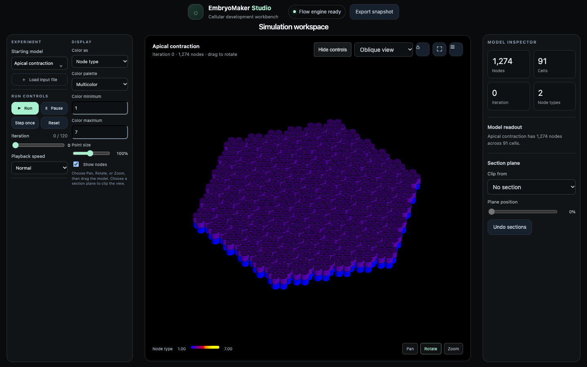

# EmbryoMaker Flow

EmbryoMaker Flow simulation and browser Studio.

**Project page and downloads:** [Open the EmbryoMaker Flow project page](https://godofecht.github.io/embryo-maker-flow/)



## What this is

EmbryoMaker is a computer model of how embryos and tissues take their shape, written in Fortran by Marin-Riera, Brun-Usan, Zimm, Välikangas and Salazar-Ciudad (2016). EmbryoMaker Flow is a new version of that model. Each cell is built from a few nodes (points that push and pull on each other), and genes inside the cells switch on and off, spread between neighbours and change how the cells grow, divide, stick together and die. Folding, migration and gastrulation (the stage where a ball of cells folds inward to form layers) come out of these local rules. Nothing about the final form is written in.

This version is written in [Flow](https://github.com/flooooooooooow/flow), a programming language made by the same author. Every ported routine is checked against the original Fortran. The simulator runs on your own computer and shows the model in your browser through a page called the Studio.

## What you can learn from it

- Biology: how gene expression controls cell behaviour. Gene products diffuse, bind and regulate one another, and drive adhesion, growth, division, polarisation, secretion and cell death.
- Biology: mitosis and apoptosis (programmed cell death) as steps in building a shape. See the `apoptosis` and `migration` examples.
- Biology: plant growth substances. The `Auxin stem growth` example puts auxin at the tip of a seven-cell stem and shows the growth response, with a control where the source is off.
- Biology: early animal development. The `sea_urchin_gastrulation` examples show cells at one pole moving inward.
- Science practice: a fair test. The Studio's paired experiments change one factor and keep the starting state, solver and number of steps the same.
- Computer Science: porting a program to a new language and proving each piece gives the same answer, bit for bit.

## Run it

### In your browser

The project page shows what the Studio looks like and links to the downloads. The simulation does not run on the website. You download it and run it on your own computer, and it then opens in your browser.

### On your own computer

**You will need:** an Apple silicon Mac, or a 64-bit Intel or AMD (x86-64) Linux computer running Ubuntu 24.04 or newer. You do not need to install Flow to run the downloaded package. [FFmpeg](https://ffmpeg.org/download.html) is optional; it lets the Studio save movies as GIFs.

1. Go to the [downloads page](https://godofecht.github.io/embryo-maker-flow/downloads/) and get the archive for your computer.
2. Extract it into a folder you can write to, such as your home folder. Keep the `reference` and `ui` folders beside the program.
3. Start it.
   - On a Mac, open `Start EmbryoMaker.command`. The Mac build is not signed, so the first time, Control-click it in Finder, choose Open, then confirm.
   - On Linux, open a terminal in the folder and run:

     ```sh
     ./start-linux.sh
     ```

4. Your browser opens at `http://127.0.0.1:8765`. If it does not, type that address in yourself. You should see a black model view with controls beside it.
5. Keep the terminal window open while you use the Studio. Press Control-C in it to stop.

If macOS still blocks the program, open Terminal in the extracted folder and run:

```sh
xattr -dr com.apple.quarantine .
./Start\ EmbryoMaker.command
```

To use another port, start with `PORT=9000 ./start-linux.sh` and open `http://127.0.0.1:9000`.

#### Using the Studio

- Choose a starting state from the **Starting model** menu.
- Select **Controls** above the model view to show the panels.
- **Run** advances the simulation, **Pause** stops it, **Step once** runs one solver step, and **Reset** goes back to the starting state.
- Right-click the model view to open the original EmbryoMaker menu. Hover a category to open its submenu.
- Drag the model to rotate it. Choose Pan, Rotate or Zoom in the display controls to change what dragging does.
- **Load input file** opens your own EmbryoMaker `.txt` or `.dat` file.

These arrow keys work when no text box is selected:

| Key | Does |
| --- | --- |
| Right arrow | run the current batch of steps |
| Up arrow | multiply the batch by ten and run it |
| Left arrow | go back one step |
| Down arrow | switch the camera or cursor movement mode |

The full guide is in [docs/user-guide.md](docs/user-guide.md).

#### Build from source

You need the [Flow compiler at pinned commit `d99d4fca8870`](https://github.com/flooooooooooow/flow/tree/d99d4fca8870dde91c8b7a0e24b66d5c30ad9102) and a C compiler. From the project folder, run:

```sh
tools/run-ui.sh
```

This compiles `ui/server.flow` and starts the server. Open `http://127.0.0.1:8765`.

## How it works

Each cell is a set of nodes. Forces between nodes give a cell its shape, adhesion and stiffness. The model treats the surroundings as thick and slow, like honey, so a force moves a node directly with no momentum. Each step, the solver finds each node's neighbours, adds up the forces, updates the genes and moves the nodes. Cells can grow, divide, polarise (point in a direction), secrete extracellular matrix (the material between cells) and die.

| File or folder | What is in it |
| --- | --- |
| `src/embryomaker.flow` | the entry point |
| `src/biomechanic.flow` | forces between nodes |
| `src/neighboring.flow` | finding each node's neighbours |
| `src/genetic.flow` | the gene network |
| `src/growth.flow`, `src/mitosis.flow`, `src/death.flow` | growth, division and cell death |
| `src/ecm.flow` | extracellular matrix |
| `ui/server.flow` | the local web server for the Studio |
| `ui/index.html`, `ui/renderer.js` | the Studio page and its 3D drawing |
| `reference/fortran/src/` | the original Fortran source |
| `reference/examples/` | the starting states |
| `tests/` | parity checks against the Fortran |
| `docs/user-guide.md` | the full user guide |

## Ideas to try

1. Copy `reference/examples/migration/migration.txt`, change one parameter in the copy, and open it with **Load input file**. Run both for the same number of steps and compare how far the cells move.
2. Read `reference/examples/auxin_stem_growth/README.md`, then run `python3 tools/run_auxin_stem_hypotheses.py` with the Studio running. Change the auxin diffusion value in `tools/create_auxin_stem_example.py` and see how far the response spreads.
3. Repeat the sea urchin gastrulation tests with `python3 tools/run_gastrulation_hypotheses.py`. One prediction in `reference/examples/sea_urchin_gastrulation_hypotheses/README.md` failed. Form a new hypothesis for why.
4. Read `src/death.flow` beside `reference/fortran/src/death.mod.f90` and see how one routine was ported line by line.
5. Write a new parity test in `tests/`, modelled on `tests/test_rng.flow`.

## Technical details

### Checks

The browser smoke check is `node tools/ui_smoke.cjs` (needs the server running and Playwright). The solver parity suite is `tools/run_flow_checks.sh`. `node tools/ui_design_smoke.cjs` checks layout, dialogs and scrolling.

### Build pipelines

`tools/build-pgo.sh` trains a clang profile that `tools/run-ui.sh` reuses. `tools/build-mlir.sh` and `tools/build-gpu.sh` are the MLIR and Metal lowering pipelines, and `tools/backend_parity.sh` compares any build with the C reference bit for bit. [PORTING.md](PORTING.md) records the measurements.

### Threads and GPU

The solver runs its neighbor scan, gene step and pair forces on a worker pool by default (`EMBRYO_THREADS=1` keeps it serial). `EMBRYO_GPU=exact64` moves the pair forces to the GPU in software binary64, bitwise equal to the CPU; `EMBRYO_GPU=preview` uses float32 there and diverges from the exact run. The Studio's Compute select switches these at run time.

### Releases

The downloads page reads the latest GitHub release. CI checks changes on `main` and pull requests. Pushing a `v*` tag builds macOS Apple silicon and Linux x86-64 packages, runs the stem morphology checks, and creates or updates the matching GitHub release.

### Files and saving

Snapshots go to `output/<model>/`. Automatic images go to `images/<model>/`. Movie capture saves a GIF through FFmpeg, or downloads a WebM recording if FFmpeg is missing. The server writes into the application folder.

### Other documents

- [PORTING.md](PORTING.md): the porting contract and measurements.
- [FLOW_IDIOMS.md](FLOW_IDIOMS.md) and [docs/flow-idioms.md](docs/flow-idioms.md): how the port uses Flow.
- [MCP.md](MCP.md): running experiments through an MCP server (Model Context Protocol, a way for an AI assistant to call the simulator).
- [ui/README.md](ui/README.md): Studio details.

## Project status

CI on `main` passes. Version 0.1.0 is the latest release, with packages for Apple silicon macOS and x86-64 Linux. There is no Intel Mac or Windows package.

## Licence

You can use, change and share this code, but anything you share that is built from it must also be released under the same licence with its source code. See [LICENSE](LICENSE) (GPL-3.0).

## Credits

- EmbryoMaker by Miquel Marin-Riera, Miguel Brun-Usan, Roland Zimm, Tommi Välikangas and Isaac Salazar-Ciudad. Marin-Riera et al., "Computational modeling of development by epithelia, mesenchyme and their interactions: a unified model", Bioinformatics 32 (2016). Source: [HugoCanoFernandez/EmbryoMaker](https://github.com/HugoCanoFernandez/EmbryoMaker).
- The viewer includes the original EmbryoMaker examples and nine saved states from [Morphospace_exploration_EMaker](https://github.com/HugoCanoFernandez/Morphospace_exploration_EMaker): Cano-Fernandez, Brun-Usan, Tissot and Salazar-Ciudad, "A Morphospace Exploration Using a General Model of Development Reveals a Basic Set of Morphologies for Early Animal Development and Evolution", Journal of Experimental Zoology Part B 344 (2025). Their source and licence details are in [the examples directory](reference/examples/morphospace_exploration/README.md).
- Written in [Flow](https://github.com/flooooooooooow/flow).
