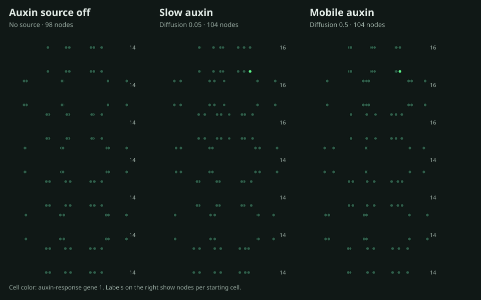

# Auxin stem growth

This is a seven-cell vertical stem built from an explicit two-ring tube geometry. Gene 2 represents auxin supplied at the tip. It diffuses between touching cells. Gene 1 is an auxin response that contributes to the simulator's cell-growth property.

The example tests two hypotheses. A tip source should activate the response and expand the apical growth zone. Higher auxin mobility should extend the response into cells below the tip.

All conditions began from the same state and ran for 5,000 iterations in serial mode.

| Condition | Auxin diffusion | Nodes | Mean response in apical cell | Mean response in cell below | Nodes by cell, basal to tip |
|---|---:|---:|---:|---:|---|
| Auxin source off | 0.50 | 98 | 0.00000 | 0.00000 | 14,14,14,14,14,14,14 |
| Slow auxin | 0.05 | 104 | 0.06229 | 0.00012 | 14,14,14,14,16,16,16 |
| Mobile auxin | 0.50 | 104 | 0.06218 | 0.00101 | 14,14,14,14,16,16,16 |

The source-off control stayed at 98 nodes and had no response. Both source-on runs added six nodes in the apical three cells. Higher mobility increased the response in the cell below the tip by about eight times. This is a small in-silico demonstration of a source, transport, response, and local growth. It does not model plant anatomy or a measured auxin transport law.



## Reproduce

Start the Studio with `tools/run-ui.sh`, then run:

```sh
python3 tools/create_auxin_stem_example.py
python3 tools/run_auxin_stem_hypotheses.py
```

The runner checks the expected differences and writes `metrics.csv`, `results.json`, `morphology.svg`, and `README.md` under `runs/auxin_stem_growth/`.
